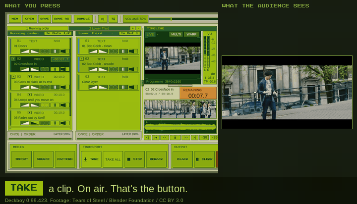
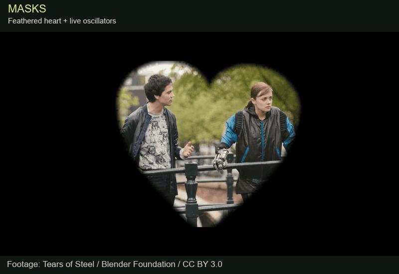
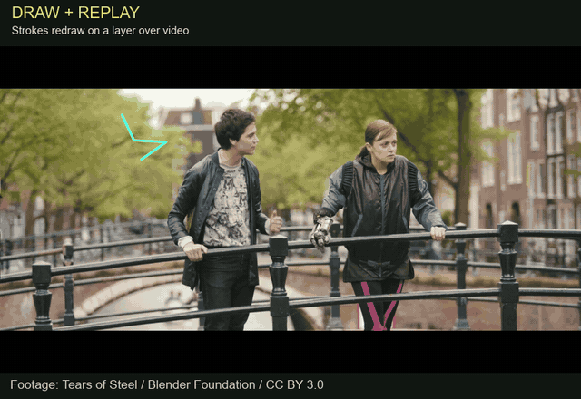
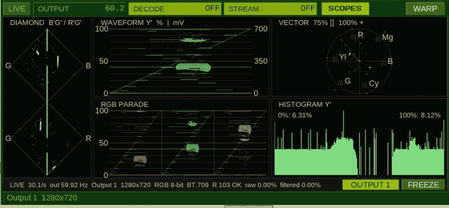
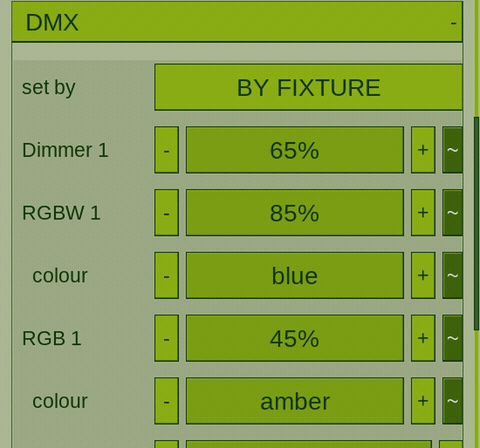
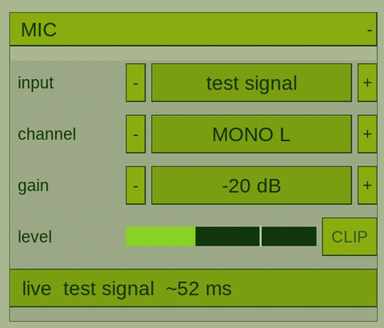
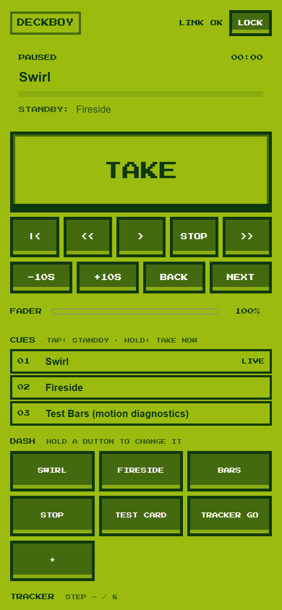
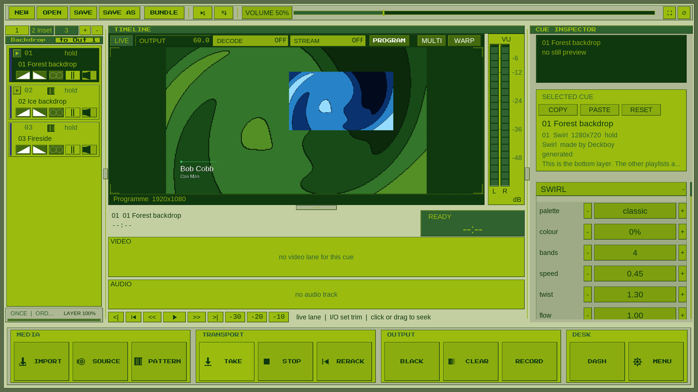
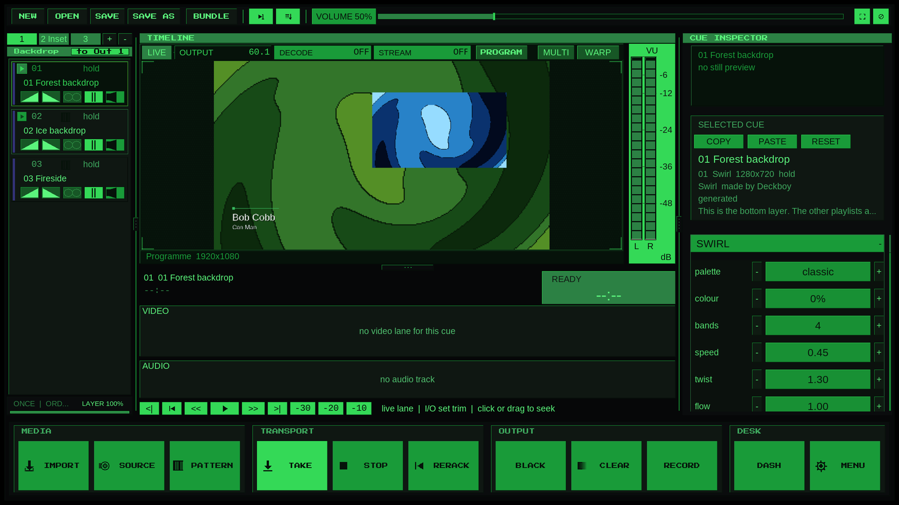
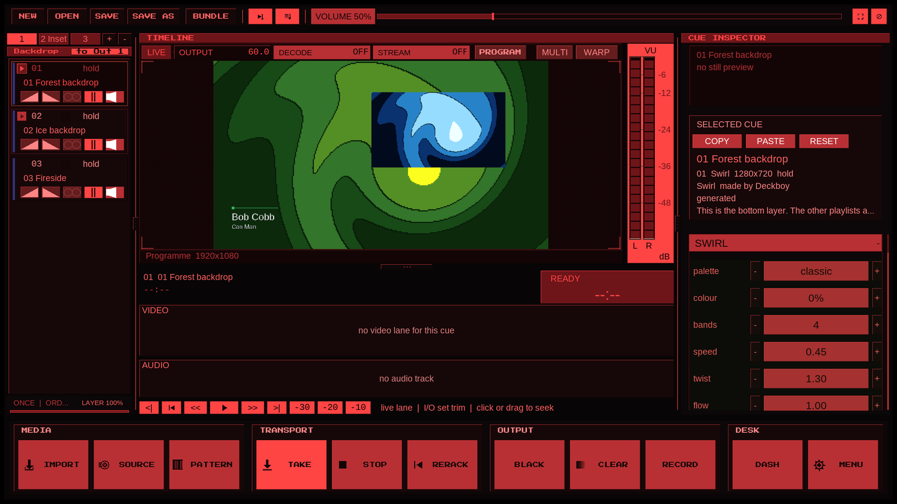

# Deckboy 🎬

[English](README.md) · [简体中文](README.zh-Hans.md) · [中文使用说明](docs/zh-Hans/使用说明.md)

> **这是 [Utopian-Academy/Deckboy](https://github.com/Utopian-Academy/Deckboy) 0.99.427（提交 `5da84439b112bca9461d20b71f0e46e4e4b733aa`）的非官方简体中文本地化，不是官方发行版。** 许可仍为 GNU GPL v3，版权归原作者（Deckboy Contributors）所有。详见 [NOTICE.zh-Hans.md](NOTICE.zh-Hans.md) / [NOTICE.md](NOTICE.md)。

<div align="center">

[](https://github.com/Utopian-Academy/Deckboy/releases/latest)
[](https://github.com/Utopian-Academy/Deckboy/releases)
[](https://github.com/Utopian-Academy/Deckboy/stargazers)
[](https://discord.gg/AZzsE4AZWx)

[](https://github.com/Utopian-Academy/Deckboy/releases/latest)
[](LICENSE)
[](https://libsdl.org)

[](https://github.com/florisporro/awesome-ndi)
[](https://github.com/RobLoach/awesome-sdl)
[](https://github.com/juancarlospaco/awesome-streaming-tools)

</div>

## 视频播放与演出控制。

Deckboy 把视频、幻灯片和现场信号源排成一场演出的运行顺序。在控制台上选好下一个 cue，准备好再 TAKE 给观众。把节目送到屏幕、广播输出或推流，并在播放的同时录制。

自由开源，适用于 Windows、macOS 和 Linux。

**[⬇ 下载](https://github.com/Utopian-Academy/Deckboy/releases/latest)** &nbsp;·&nbsp; **[▶ 观看 Deckboy 演示](https://utopian-academy.github.io/Deckboy/trailer.html)** &nbsp;·&nbsp; **[♡ 社区与帮助](https://utopian-academy.github.io/Deckboy/community.html)**



<sub>你按下的，和观众看到的，来自一次 v0.99.423 的实际运行。[观看配有 YMCK 音乐的 Deckboy 演示](https://utopian-academy.github.io/Deckboy/trailer.html)。素材：[Tears of Steel](https://mango.blender.org/)，Blender Foundation，[CC BY 3.0](https://creativecommons.org/licenses/by/3.0/)。</sub>

**如果 Deckboy 对你有用，请给本仓库点 ⭐**（右上角）：下一个操机员会因此找到它，你也能再次找到它。

### 界面语言

完整安装包已包含简体中文界面。打开 Deckboy 后，到 **设置 → Language（语言）**，选择 **简体中文**，无需重启。语言选择器旁的 **Help!** 按钮始终为英文，并会把界面恢复为英文，以免选错语言后无法操作。

本汉化包在上游简体中文词库基础上补全了按钮、菜单、设置、提示和错误信息，并提供中文安装与使用说明。详细步骤见 [中文使用说明](docs/zh-Hans/使用说明.md)。TAKE、PROGRAM、NDI、SRT、OSC 等行业术语按项目惯例保留英文。

### 0.99.425 中的新内容

[发行说明与下载](https://github.com/Utopian-Academy/Deckboy/releases/tag/v0.99.425)

 

<sub>0.99.425 中的遮罩与绘制。素材：[Tears of Steel](https://mango.blender.org/)，Blender Foundation，[CC BY 3.0](https://creativecommons.org/licenses/by/3.0/)。</sub>

- **MIDI 映射。** 可用任意 MIDI 控制器或 OSC 消息运行任何 Deckboy 命令。按 LEARN，再拧旋钮或按键即可连接。控制器上的灯会跟随演出。已内置 KORG nanoKONTROL2、Novation Launch Control XL、AKAI APC mini mk2 和 AKAI APC40 mkII 的现成映射。
- **遮罩。** 把画面裁成某种形状：圆、心、星，或用笔自己画。可把遮罩加在一个 cue、一个播放列表或整个输出上。边缘可以做软、随时间移动，并按 SVG 导入或导出。
- **切片。** 把画面的不同部分送到输出上的不同位置，适合 LED 屏和异形屏幕。在新的「屏幕」窗口里把每个切片拖到位置上。
- **绘制。** 用鼠标或笔在画面上画。可把画存成静帧或带透明度的视频，或按绘制过程回放。
- **动作。** 摄像机可以控制 Deckboy：镜头前的运动会改变你选定的任何控件。短游戏 Bug Swat 会教你怎么用。
- **其它新内容：** 又多了十七课、跟随声音音高的 Chladni 效果、运动拖影效果、新的多画面布局，以及越南语、老挝语和阿鲁巴帕皮阿门托语，还有 Beast 模式。
- **已知问题（Windows）：** 两块屏幕刷新率不同时（例如 59.94 Hz 和 60 Hz），输出大约每 15 秒会丢帧或重复一帧。发生时 Deckboy 会提醒。目前请把屏幕设成同一刷新率（[方法](MANUAL.md#screens-at-different-refresh-rates)）。

### 再近看一看

<table>
<tr>
<td width="50%"><b>画面示波器</b><br><br>由运动测试卡得到的波形、矢量、分量队列和色域测量。</td>
<td width="50%"><b>按名称控制灯光</b><br><br>cue 列表里的灯具电平与颜色。</td>
</tr>
<tr>
<td width="50%"><b>现场输入，按 cue 调用</b><br><br>话筒 cue 的增益和电平表，用内置测试信号展示。</td>
<td width="50%"><b>手机控制器</b><br><a href="https://utopian-academy.github.io/Deckboy/#phone-demo"></a><br><a href="https://utopian-academy.github.io/Deckboy/#phone-demo">观看它选中并 TAKE cue。</a></td>
</tr>
</table>

<details>
<summary><b>当前控制台的三种主题</b></summary>

**Gameboy**



**Dark**



**Virtual Boy**



</details>

[所有截图、GIF 和片段](https://utopian-academy.github.io/Deckboy/press.html#images)
都是真实的应用捕获。控制台、叠化、效果和示波器：已发布的 v0.99.419。
其它捕获在[媒体说明](docs/images/readme/README.md)中保留各自的原始版本。

刚接触 Deckboy？在启动画面选择 **EXAMPLE SHOWS（示例演出）**，阅读每个 cue 上的注释，再把演出改成你自己的。

### 一切都是 cue

一段视频。一张静帧。一张幻灯片。一路现场摄像机。本机上的一个窗口。一个网页。一路 NDI 源、一路 SRT 信号、一路 SDI 输入。一张测试卡、一个倒计时、一条下方字幕条、一个音频文件、一路校音。你在画面上现场输入的一行代码。在 Deckboy 里，这些都是同一种对象，排在同一份 cue 列表上，行为也一样：同样的走带、同样的淡变、同样的十七种转场、同样的效果架、同样的远程控制，出去时也用同样的方式录制。

所以一场演出可以按

```
VIDEO → SLIDE → LIVE CAMERA → WEB PAGE → SRT FEED → TEST CARD → VIDEO
```

由一名操机员、一个空格键完成，不用来回切窗口，因为其中没有任何一项是特例。通常要做到这些，需要播放器、幻灯片软件、浏览器、采集工具、推流工具和测试图发生器，每样都有自己的操作方式。

## 社区与帮助

- [社区主页](https://utopian-academy.github.io/Deckboy/community.html)
- [GitHub Discussions](https://github.com/Utopian-Academy/Deckboy/discussions)
- [在线手册（英文）](https://utopian-academy.github.io/Deckboy/manual.html) 与 [FAQ](https://utopian-academy.github.io/Deckboy/faq.html)
- [中文使用说明](docs/zh-Hans/使用说明.md) 与 [帮助与社区（中文）](docs/zh-Hans/SUPPORT.zh-Hans.md)

## 下载

**[试用示例演出](data/demos/starter-pack/README.md)** — 五场由浅入深的演出：一块屏幕上的一张图、一份运行顺序、图层与标题、外观与效果，以及一场 39 秒、用一个按钮跑完并配有原创音乐的演出。打开 `.deckboy` 文件，按 cue 注释操作。

下面的功能描述对应当前源码。已打包的构建及其版本变更列在[发行页](https://github.com/Utopian-Academy/Deckboy/releases)。

每个发行版都为各平台提供**安装包**和**便携版**。两者都捆绑应用程序、FFmpeg 及其运行库，用于普通文件播放。NDI 使用单独安装的 NDI 运行时；SDI 使用兼容的 Blackmagic 硬件和 Desktop Video。Office 幻灯片转换使用本机上的 PowerPoint、Keynote 或 LibreOffice。[完整要求](https://utopian-academy.github.io/Deckboy/specs.html#system)。

| 平台 | 安装包 | 便携版 |
|---|---|---|
| **Windows** | `…-windows-x64-setup.exe` — 开始菜单、卸载程序、`.deckboy` 文件关联 | `…-windows-x64.zip` |
| **macOS**（Apple Silicon） | `…-macos-arm64.dmg` — 拖到「应用程序」 | `…-macos-arm64.zip` |
| **macOS**（Intel） | `…-macos-x86_64.dmg` | `…-macos-x86_64.zip` |
| **Linux** | `…-x86_64.AppImage` — 单个文件，`chmod +x` 后运行；或 `…-x86_64.flatpak` | `…-linux-x86_64.tar.gz` |

**Deckboy Mini** 包含在上述所有包中，也可单独下载，大约 12 到 18 MB：`Deckboy-Mini-…-windows-x64.zip`、`…-macos-arm64.zip`、`…-macos-x86_64.zip`、`…-linux-x86_64.tar.gz`，以及面向 Raspberry Pi（64 位）或任何 ARM64 Linux 的 `…-linux-arm64.tar.gz`。

两个控制面也随每个发行版提供，无需自行编译：**Stream Deck**（`…streamDeckPlugin` — 双击安装）和 **Bitfocus Companion**（`Deckboy-companion-module-….zip` — 解压后，把 Companion 的 *developer modules path* 指到包含它的文件夹；其中的 `INSTALL.txt` 有三步说明）。Companion 模块需要 **Companion 5**。

→ **[最新发行版](https://github.com/Utopian-Academy/Deckboy/releases/latest)**

也可以用跟随每个新发行版更新的包管理器：

```powershell
# Windows (Scoop)
scoop bucket add deckboy https://github.com/Utopian-Academy/scoop-deckboy
scoop install deckboy/deckboy
```

```sh
# macOS (Homebrew)
brew install --cask utopian-academy/deckboy/deckboy
```

<details>
<summary><b>「未知开发者」警告 — 该怎么做</b></summary>

Deckboy 的 Windows 构建未签名，macOS 构建为 ad-hoc 签名。两者都没有已验证的发行者签名，所以第一次打开下载时系统可能会警告。

- **macOS** — 如果提示应用已损坏，请清除一次隔离标记：

      xattr -dr com.apple.quarantine /Applications/Deckboy.app

  请从 `.dmg` 安装到「应用程序」，不要从「下载」直接运行；这样也可以避免 Gatekeeper 的 App Translocation 沙盒。
- **Windows** — SmartScreen 可能会说「Windows 已保护你的电脑」。点击 **更多信息 → 仍要运行**。
- **Linux** — AppImage 可在 **Ubuntu 22.04 及更新版本** 上运行，很多场地机器仍是这个版本。图形、显示服务器、音频和 C/C++ 运行时有意使用主机提供的版本：它们必须匹配实际运行的机器，捆绑的 libGL 无法加载你的 GPU 驱动。每次启动都会检查这一下限，而不是想当然。

</details>

Deckboy 会在启动时检查界面标签，并在需要时自动尝试另一条渲染路径。[FAQ](https://utopian-academy.github.io/Deckboy/faq.html#interface-text) 说明了渲染器日志，以及如何在 Mac 上选择软件渲染。

---

## 它是什么

Deckboy 是一款面向视频工程师、AV 技术员和现场操机员的原生桌面应用，用来可靠地组织媒体、触发 cue、循环内容和把视频送到演出显示设备。

这就是它被设计出来要做的工作，原则也很简单：

**Seize the means of playback ♡**（掌握播放的手段）

没有订阅 ♡ 没有账户 ♡ 没有遥测 ♡ 不会偷偷联系开发者。更没有许可证服务器会在 19:55 因为连不上网而拒绝开演。你带进场地的那台机器，就是播放这场演出的机器。

### 什么可以成为 cue

| | |
|---|---|
| **视频** &middot; **图片** &middot; **音频** | 文件，硬件解码，可修剪、可淡变 |
| **幻灯片** | PDF、PowerPoint 或 Keynote，每张幻灯片一个 cue，带备注 |
| **浏览器** | 把网址渲染进节目，而不是桌面上另开一个浏览器窗口 |
| **窗口** &middot; **屏幕** &middot; **摄像机** | 现场采集，使用窗口自身的完整分辨率 |
| **NDI** &middot; **SRT / RTMP / RTSP / UDP** &middot; **DeckLink** &middot; **Spout** | 别人的信号，作为 cue 接入 |
| **测试图** &middot; **测试卡** &middot; **音调** | 当场生成，不需要文件 |
| **计时器** &middot; **下方字幕条** | 舞台倒计时，全屏或叠在节目上，以及 52 种样式的下方字幕条 |
| **视频合成器** &middot; **代码** | 带反馈的振荡器，或你现场输入的表达式 |

每一行都使用同样的淡变、同样的转场、同样的效果架、同样来自 Stream Deck 的触发，出去时也用同样的方式录制。
[手册第 5 章（英文）](https://utopian-academy.github.io/Deckboy/manual.html#cue-types)
是按源逐一列出的完整表。

### 因此它也是一把很好用的视频瑞士军刀

这不是第二份功能清单，而是第一份清单自然带来的结果。如果摄像机是 cue、SDI 是输出，这台机器就是转换器。如果推流是 cue、NDI 是输出，它就是桥。如果测试卡是 cue，它就是能验证真实链路、而不是测试盒自己的测试图发生器。

同一台机器会说 NDI、SDI、SMPTE ST 2110、SRT、RTMP、Spout、LTC 时间码、OSC、Art-Net 和 NMOS — 所以你为播放带去的机器，当天另外五个问题通常也能一起解决。

- **转换媒体**：播不好的文件可在应用内原地转换，不用离开 Deckboy
- **检查任何文件** — 导入即可看到编码、光栅、帧率、声道、时长
- **生成测试图和测试卡**，端到端验证链路
- **采集** 摄像机、窗口或屏幕，并当作 cue 使用
- **桥接格式** — 把摄像机、采集卡或推流接进来，再把节目以 SDI、ST 2110 或推流送出，同时录制
- **响度归一化** 到选定的 −16、−23 或 −24 LUFS 目标后再播放
- **生成 LTC 时间码**，走独立可路由的输出

### 用在哪里

现场活动 • 企业演示 • 教堂 • 中小学与大学 • 博物馆与装置 • 数字标牌 • 投影 • LED 屏 • 直播

以及这些之间的工作：在任何人到达之前先测试一块屏幕，用真实测试卡验证线缆或转换器，把摄像机或推流送到 SDI，再推到 SRT 或 RTMP，或在开门前几分钟把客户无法播放的文件变得可播。

### Deckboy Mini

**给一块没人值守的屏幕：** 门厅循环、后台监视器、随电脑启动的信息亭。`deckboy-mini` 与 Deckboy 一起提供：指向片段或文件夹，它就会用与控制台相同的引擎全屏播放，按名称排序，静帧会保持，需要时可循环。它在控制台的端口上响应控制台的远程命令，所以 Companion 可把它当作 1 号卡座来驱动；整场演出也可在其终端里用键盘运行，SSH 也可以：重排、重命名和删除 cue，保存和打开播放列表（M3U8），选择显示器和声音设备，以及播放器该有的键 — 逐帧、速度、A-B 循环、静音、音轨和字幕。它还保留播放器的运行顺序习惯：按名称查找 cue、排队下一个、播完这条就停、随机、倒计时时钟，以及 cue 之间的叠化。除 M3U8 外也打开 `.pls` 列表。在 Raspberry Pi 上通过板载视频解码器播放；`tools/linux_build.sh --mini` 可在那里编译。它自己的[迷你手册（英文）](https://utopian-academy.github.io/Deckboy/manual.html#deckboy-mini)列出了每个键和命令。Mini 包含在每次下载中，也可在[发行页](https://github.com/Utopian-Academy/Deckboy/releases/latest)单独下载 Windows、macOS、Linux 和 Raspberry Pi（64 位）版本。

```
deckboy-mini ~/Videos --display 2 --loop
```

在 Windows PowerShell 中，请在其所在文件夹用 `.\deckboy-mini` 启动；PowerShell 不会按光名运行当前文件夹里的程序。也可以把文件拖到 `deckboy-mini.exe` 上。


---

## 功能

完整列表很长，因为能成为 cue 的东西很多。它单独放在一页：**[全部功能（英文）](FEATURES.md)**，分为九组：

- 播放与 cue
- 信号源 — 一切可以成为 cue 的东西
- 输出 — cue 可以去的所有地方
- 用幻灯片演示
- 广播 / IP 视频
- 音频
- 演出控制
- 效果与混音
- 界面

## 为操机员而做，不是为收集数据

Deckboy 不收集任何信息，也不向开发者发送任何信息。**没有遥测、没有使用报告、没有崩溃上传、没有账户。** 崩溃日志写在应用旁边的文件里，供你阅读或转发，并留在那里。

有一项更新检查，而且**默认关闭**。打开后，它只向 GitHub 的 releases API 询问是否有新版本 — 询问中不包含关于你的任何信息，发现新版本也绝不会在你同意之前安装任何东西。放在场地网络上的机器，不应该做任何没人要求它做的事。

它确实会主动使用网络 — NDI 发现、PTP、NMOS 注册、OSC、Companion 控制和推流都会按设计与网络通信。这些每一项都只通往你自己的局域网，或你配置的目标。

---

## 平台

同一份演出文件可在 Windows、macOS 和 Linux 上打开，上面几乎所有功能在三个平台都能运行。例外：与 Resolume、TouchDesigner 或 OBS 的纹理共享是 Spout，仅限 Windows。

只要平台提供硬件解码就会使用 — D3D11VA、Video Toolbox、VAAPI — 在 Windows 和 macOS 上，画面到达屏幕的途中不经过系统内存：4K 大约少用十倍 CPU，这些 CPU 就能留给其它事情。

---

## 文档

- [中文使用说明](docs/zh-Hans/使用说明.md) — 安装、切换语言、基本操作与本汉化说明
- [代码地图（英文）](docs/CODEMAP.md) — 文件清单、数据流、线程模型
- [打包指南（英文）](docs/PACKAGING.md)
- [变更日志（英文）](CHANGES.md)
- [ST 2110 可行性（英文）](docs/ST2110_FEASIBILITY.md)

变更日志是功能落地以及（同样重要的）每项功能有意不做哪些事的权威记录。

---

## Deckboy 的朋友

- [AV Tools Pro](https://avtoolspro.com/) — 免费的 AV 设计计算器：投影机投射比与亮度、AVoIP 和 Dante/AES67 带宽、电视墙与 LED 点距、线缆、机柜和 PoE 规划

---

## 路线图

上游英文 README 中的路线图（音频、DJ 与采样、演出控制、界面定制、学习、画面、示波器、Deckboy Mini、网页监视器与网络、平台）仍以 [README.md](README.md#roadmap) 为准，此处不重复展开。

---

## 许可证

Deckboy 是自由软件，采用 **GNU General Public License v3.0 或更高版本**。
Copyright © 2026 Deckboy Contributors。全文见 [LICENSE](LICENSE)。

捆绑组件保留各自的许可证 — ffmpeg 随二进制附带其 LGPL/GPL 声明，NDI 和 DeckLink SDK 在运行时加载，而不随本程序分发。

NDI® 是 Vizrt NDI AB 的注册商标。

## 非官方功能扩展（本仓库功能分支）

同一 feature 分支还提供：**原生 PowerPoint 放映**（Windows + 桌面版 PowerPoint，外部窗口，不是节目/NDI 合成；完整 Windows 包在 Deckboy.exe 同目录附带 deckboy-ppt-helper.exe，Mini 不含）、**演讲计时**（展示默认在观众/节目窗口，可改到演讲者窗口；设置与展示分离）、以及**节目与预听双音频总线**（可同时正式播放当前素材并在另一设备预听下一个，预听设备失效时静音且不会回退到 HDMI）。

说明、限制与未做的实机验证见 [PowerPoint演讲计时与音频路由.md](docs/zh-Hans/PowerPoint演讲计时与音频路由.md)（英文：[POWERPOINT_SPEECH_TIMER_AND_AUDIO.md](docs/POWERPOINT_SPEECH_TIMER_AND_AUDIO.md)）。

本简体中文文档与界面翻译不改变原项目的许可证与作者信息。

---

## 参与贡献

Deckboy 在开放中构建，欢迎贡献 — 代码、缺陷报告、文档、测试，或来自真实演出的反馈。

最好的开源工具，是由使用它们的社区一起做出来的。

---

## 项目状态

在全部三个平台上活跃开发。Windows、macOS 和 Linux 使用同一份源码构建，每次提交都由 CI 在完整功能和精简功能配置下检查 — macOS 为自包含应用包，Linux 为便携 tarball 和 AppImage。
